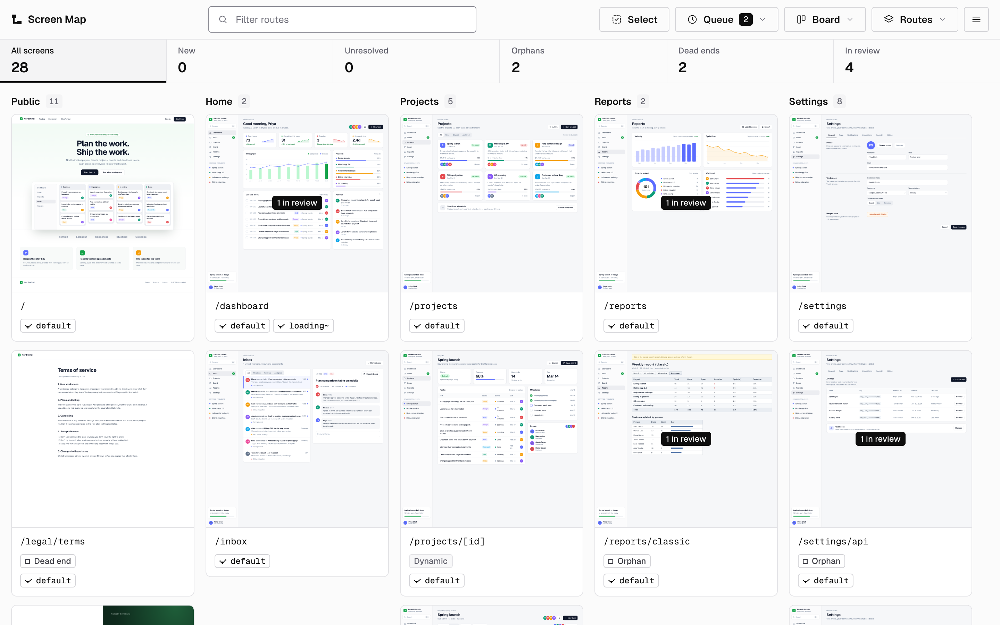

# @excellent-so/screen-map

One command screenshots every route of your running app, graphs how the routes link to each other, and
finds the orphan pages nothing links to. It runs on your machine and has no runtime dependencies.



**What works where.** Route discovery and orphan finding work for Next.js App Router apps: Screen Map
reads every route from your `app/` (or `src/app/`) folder, screenshots each one, and reports the routes
nothing links to. Other apps get the crawl only: Screen Map follows links from `/` on your running app,
screenshots the pages it reaches and maps the links between them, without an orphan report. In a Next app,
a page the crawl reaches that isn't in the folder (a Pages Router page, a rewrite) gets a screenshot too.

## Quick start

You need Node 20 or later, Chrome installed (Chromium, Edge and Brave work too), and your app's dev server
running. In your project's root, with `next dev` serving http://localhost:3000:

```sh
npx @excellent-so/screen-map build
npx @excellent-so/screen-map open
```

`build` writes the map to `.screenmap/` (add that folder to `.gitignore`). `open` serves the viewer on
http://localhost:4610, or the next free port, and opens it in your browser. If your dev server is on another
address, pass it to `build`:

```sh
npx @excellent-so/screen-map build --base=http://localhost:3001
```

A standard App Router app needs no config file. To keep Screen Map in the project, install it as a dev
dependency and add a script:

```sh
npm i -D @excellent-so/screen-map
```

```json
{ "scripts": { "map": "screen-map build && screen-map open" } }
```

## What it does

1. **Lists every route** from the App Router folder, including routes that nothing links to.
2. **Finds the states a route hides**: a wizard's steps, a page's tabs, a tour's slides. It reads them from
   the route's own source (see [State screens](#state-screens)).
3. **Screenshots each screen** by loading your running app in headless Chrome.
4. **Graphs the links** it finds in your source (`<Link href>`, `router.push`, `redirect`) and on the
   rendered pages, and crawls the running app from `/` to check them.
5. **Reports orphans and dead ends.** A route with no links in is an orphan, and any route the crawl can't
   reach is listed in the map as a proven orphan. A page with no links out is a dead end.
6. **Gives your review notes a home.** In the viewer, select screens, write a note and copy a brief for
   your coding agent. When the agent is done, recapture the screens and approve the change.
7. **Turns notes into tracked work**: a markdown file or a GitHub issue.

## The viewer

The viewer has four views: the board (a column per route group, or a sortable table), the flow graph, the
review pipeline (notes by stage), and prototype review. It opens in the light theme; choose Dark in its menu
and it remembers. Served by `open` or `serve`, it saves notes to `.screenmap/notes.json`. Its look comes from
`@excellent-so/kit` (MIT).

## Commands

| Command | What it does |
|---|---|
| `screen-map build` | Run the whole pipeline and write `.screenmap/screenmap.json` |
| `screen-map open` | Serve the viewer and open it in your browser |
| `screen-map serve` | Serve the viewer (notes save to disk) |
| `screen-map regraph` | Rebuild the graph from the last build's screenshots, without Chrome |
| `screen-map recapture --ids=a,b` | Screenshot some screens again and re-read their links (after a fix) |
| `screen-map route` | Turn review notes into tracked work (see [Findings](#findings)) |
| `screen-map diff` | Show what changed since the last build |
| `screen-map init` | Write a starter `screen-map.config.mjs` |
| `screen-map doctor` | Report the config, Chrome and output adapters it found |
| `screen-map bug` | Report a bug in Screen Map itself, as a GitHub issue (see [Reporting a bug](#reporting-a-bug)) |

Useful `build` flags: `--base=<url>` (your dev server), `--no-capture` (graph only, no Chrome),
`--no-crawl` (skip the crawl), `--only=g1,g2` (only these route groups), `--concurrency=N`, `--limit=N`,
`--crawl-capture-max=N` (see [Discovery](#discovery)), `--download-chrome` (fetch Chrome if none is
installed), and `--managed-server` (see [Running its own dev server](#running-its-own-dev-server)).
`screen-map help` lists them all.

## Configuration

A standard Next.js App Router app needs no config. To change something, add a
`screen-map.config.{mjs,js,json}` to your project's root (`screen-map init` writes one):

```js
export default {
  appDir: "app",                       // or "src/app"; found automatically if left out
  devBaseUrl: "http://localhost:3000", // the --base flag or SCREENMAP_BASE overrides it
  framework: "next-app-router",        // the discovery adapter
  discovery: ["router-walk", "crawl"], // drop "crawl" to skip the crawl
  crawlCaptureMax: 100,                // screenshots of pages only the crawl finds; 0 for none
  groups: (route) => route.split("/")[1] || "root", // the board's columns
  navBackbone: [],                     // global nav targets, so nav-only pages aren't orphans
  noChromeRoots: [],                   // route roots without the global nav (auth pages)
  coldStartPattern: null,              // a regex that marks empty-state components
  flows: [],                           // declared multi-step flows
  stateSweep: true,                    // find the states a route hides (see below)
  statePreview: null,                  // a query param that forces a gated state: { param, value }
  routeUrls: {},                       // concrete URLs for dynamic routes (see below)
  output: { adapter: "markdown" },     // "markdown" or "github"
  server: null,                        // run its own dev server (see below)
};
```

The values shown are the defaults: leave a key out to keep its default.

**Dynamic routes.** Screen Map fills `[id]` and `[slug]` routes with seed values, then by taking a real
detail link from the nearest index page. When neither works (one `[id]` shared by unrelated routes, a detail
route with no index page to read), pin the route to a concrete URL in `routeUrls`, or in a gitignored
`.screenmap/route-urls.json`:

```js
routeUrls: {
  "/leads/[id]": "/leads/42",
  "/o/[uid]": "/o/01H…",
},
```

## Running its own dev server

By default Screen Map captures against the dev server you keep running. For long or unattended runs, give it
a `server` block and it starts its own dev server on a free port, captures against it, and stops it
afterwards:

```js
export default {
  server: {
    command: "next dev",          // your dev command
    readyPath: "/",               // polled until the server answers
    // port: 0,                   // 0 picks a free port
    // distDirEnv: "MYAPP_DIST",  // an env var your app reads to move its build folder,
    // distDir: ".next-screen-map", //   so two Next dev servers don't share one `.next`
    // env: { MYAPP_DATA_DIR: "/tmp/scratch" }, // point the app at throwaway data
    // prepare: "node scripts/seed-scratch-db.mjs", // run once before it starts
    // autostart: true,           // use it on every build, without the flag
  },
};
```

```sh
screen-map build --managed-server
screen-map build --managed-server --server-port=4700
```

A server that stops answering is restarted on the same port, screenshots that failed are tried once more,
and the server is stopped on exit, on Ctrl-C and on SIGTERM.

## State screens

The route walk gives one screenshot per route, but many routes show several screens: a query param the page
reads (`/tour?mode=preview&step=3`) or a dynamic segment with a fixed set of values (`/welcome/[step]`).
With `stateSweep` on (the default), Screen Map reads those values from the route's own source (a string
union type, an `as const` list, or the array a numeric param indexes) and screenshots one screen per state.
It only expands a route when it can name every value, so a free-text `?q=` stays one screen.

```js
stateSweep: { enabled: true, maxPerRoute: 24, maxTotal: 400 }, // or true / false
```

If a route redirects unless it's in a valid state, `statePreview` adds a query param that your app reads to
show that state anyway:

```js
statePreview: { param: "preview", value: "1" },
```

Declared `flows` take precedence: the sweep skips any route a flow already covers.

## Discovery

Screen Map combines two sources:

- **The route walk** lists every route in the App Router folder, including routes no page links to. Only
  Next.js App Router apps have one.
- **The crawl** loads your running app from `/` and follows its links. It sees what the app really renders,
  works for any framework, and checks the links the walk found in source.

A route the walk lists and the crawl never reaches is a proven orphan. On an app without an App Router
folder there is no walk, so the map is the crawl alone: the pages reachable from `/`, each with a
screenshot, and their links.

A page only the crawl finds is screenshotted like the walk's routes, at the same size and settings, and
sits on the board in its path's group. It's never an orphan: the crawl reached it by a link. A URL that
isn't a page of the app (a stylesheet, a feed, an error status, a redirect to another site) stays on the
map without a screenshot and says why. These pages have no source file to show when they change, so every
build screenshots them again. To keep a big site's build short, at most `crawlCaptureMax` of them get
screenshots (100 by default, nearest `/` first; `0` takes none), and `--crawl-capture-max=N` sets it for
one build. The crawl itself stops after 200 pages (`--crawl-max=N`).

## Findings

A note you leave in the viewer becomes a finding: the screens, their live URLs, their screenshots, and
whether they are orphans or dead ends. Send it somewhere:

```sh
screen-map route --adapter=markdown   # append to .screenmap/findings.md and print it (the default)
screen-map route --adapter=github     # open a GitHub issue (needs GITHUB_TOKEN)
```

`screen-map route --dry-run` prints the findings without sending them.

## Editor extension

The [extension](./extension) folder holds a VS Code extension that runs the CLI and shows the viewer in the
editor. It works in Cursor, Windsurf and VSCodium too.

## Reporting a bug

`screen-map bug` asks for a title and a description (or takes `--title`, `--description` and
`--severity=low|medium|high`), shows you the issue it makes, with your Screen Map, Node and OS versions under
the description, and prints a link that opens it on
[GitHub](https://github.com/excellent-so/screen-map/issues) with everything filled in. You check it there and
submit it. A long description is cut to keep the link under 7,000 characters; the command says so, and you
can paste the rest into the issue.

## What it sends

Nothing leaves your machine unless you ask: `route --adapter=github` opens an issue through the GitHub API.
`screen-map bug` sends nothing itself; the issue is filed only when you submit it on GitHub.

## Development

```sh
git clone https://github.com/excellent-so/screen-map.git
cd screen-map
npm test                  # the test suite (no Chrome needed)
npm run test:standalone   # build a real map with nothing else installed: an empty HOME, a bare PATH, no inherited variables
npm run styleguide        # copy the viewer's CSS into viewer/styleguide.html
```

The viewer is one file, `viewer/index.html`. Its tokens and components come from `@excellent-so/kit`, written
between the `excellent-kit` markers in its `<style>` by the kit's `sync` command
(`npx @excellent-so/kit sync viewer/index.html viewer/styleguide.html --fonts`, which embeds Geist and Geist
Mono so the viewer looks the same on every machine). Screen Map's own parts follow between the `screen-map`
markers. `viewer/styleguide.html` shows those parts.

## License

MIT © Excellent
